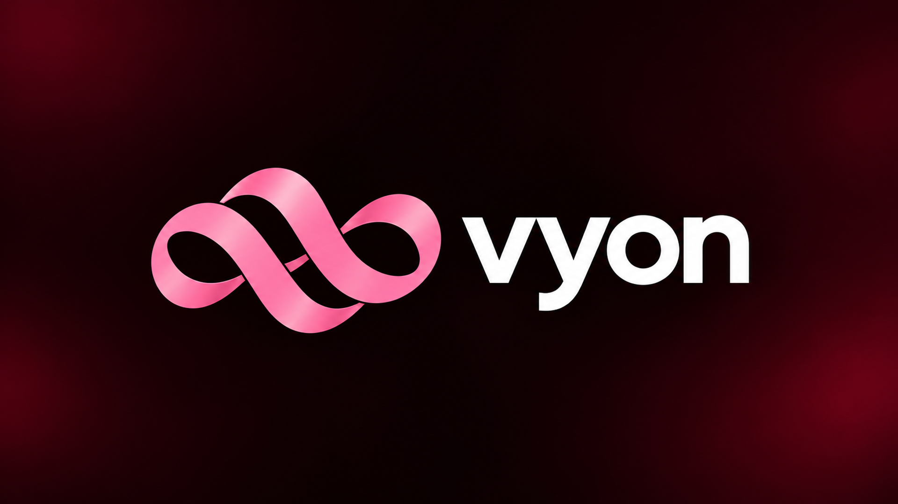

 

# vyon

### Music, on your terms.

**Discover more. Download more. Listen your way.**

A music player powered by YouTube Music, built for Android, desktop, TV, and beyond.

 

 

[**🌐 Explore vyon.live**](https://vyon.live) &nbsp;·&nbsp;
[**⬇️ Get vyon**](https://github.com/bxanedot/vyon/releases) &nbsp;·&nbsp;
[**🎵 Features**](#download-your-music) &nbsp;·&nbsp;
[**💬 Feedback**](https://github.com/bxanedot/vyon/issues)

 

---

## Download your music

**Save individual songs for offline listening.**

Choose an individual track and use its **Download** action. Available sources and controls vary by platform.

### Downloads that you control

- **Download manager** — see what's queued, follow transfer progress, and cancel or retry downloads.
- **Quality options** — choose your preferred download quality, including lossless when a compatible source supplies it.
- **Offline listening** — play songs already saved on your device without fetching them again.
- **Artwork and metadata** — save track information and cover art where the source and file format support them.
- **Network preferences** — Android offers Wi-Fi-only downloading and optional export of supported downloaded files.

  

---

## Discover, collect, play

| Feature | Experience |
| --- | --- |
| 🔎 **Search & discovery** | Find tracks, artists, albums, and playlists through the music catalog. |
| ❤️ **Your library** | Keep favorite tracks and music collections within reach. |
| 📝 **Playlist controls** | Create and manage playlists, queue songs, and reorder your own playlists where supported. |
| 🔀 **Queues & autoplay** | Play next, shuffle, reorder listening, and keep music going with autoplay. |
| 📺 **Music & video** | Switch between music listening and available video playback experiences. |
| 📁 **Local music** | Play music stored on your device; Android also includes SMB and WebDAV music-source integrations. |

## Sound, your way

**The player is as much about how music sounds as what you listen to.**

- 🎚️ **Equalizer & presets** — tune playback to your preferences.
- 🌊 **Crossfade** — ease the transition between tracks.
- ✨ **Automix** — smart transition planning informed by track analysis.
- 🔊 **Audio-quality controls** — select streaming quality, with separate Wi-Fi and mobile-data preferences on Android.
- 💎 **High-quality sources** — support for compatible lossless formats and Dolby Atmos audio paths when the source, device, and decoder allow it.

These audio capabilities vary by platform, format, and connected music source. Lossless or Atmos playback is not guaranteed for every song.

## Lyrics, artwork & atmosphere

- 🎤 **Synced lyrics** — follow lyrics while music plays, with line- and word-level timing when available.
- 🌍 **Lyrics translation** — read translations in supported languages when available.
- ⏱️ **Lyrics timing controls** — adjust synchronization offsets to match playback.
- 🖼️ **Animated cover art** — motion artwork and Canvas-style visuals for supported releases.
- 🎨 **Reactive player** — album-art-inspired colors, gradients, and immersive playback screens.
- 🫧 **Distinct UI** — custom layouts and polished visual effects across desktop, phone, and TV.

---

## Better together

**Listening doesn't have to be a solo experience.**

| Integration | What it brings |
| --- | --- |
| 👥 **Listen Together** | Shared rooms with synchronized playback state, queue changes, and host/listener controls when connected to a compatible server. |
| 🎮 **Discord presence** | Show what you're listening to with supported Discord Rich Presence integration. |
| 📊 **Listening statistics** | Explore listening history and insights tracked by the app. |
| 🎧 **Last.fm / ListenBrainz** | Scrobble listening activity through supported account integrations. |

Listen Together coordinates playback; it does **not** host or redistribute audio. Each participant needs access to playable music through their own source.

---

## Made for every screen

  
  

Desktop & TV artwork from the vyon project

| Platform | Experience |
| --- | --- |
| **Windows, macOS & Linux** | Desktop music player with its own interface, downloads, audio controls, and integrations. |
| **Android phones & tablets** | Touch-first player with downloads, music library, customizable playback, and device integrations. |
| **Android TV** | Living-room interface designed for a bigger screen and remote-control navigation. |
| **Wear OS** | Companion experience paired with the Android app. |

**iOS and iPadOS are not supported.** Some features and downloadable builds may be available on only certain platforms.

---

## Get vyon

**Ready to listen?** Find official builds and available installers below.

Vyon's website only links directly to installers it can verify in published GitHub releases. If no build is published for your platform yet, check the [Releases page](https://github.com/bxanedot/vyon/releases) for updates.

GitHub badges display live repository statistics. The download counter measures **GitHub Release asset downloads**, not active users, website visits, or installed copies. A repository without published release assets may show zero or an unavailable value.

---

## Questions?

<strong>Can I save a song for offline listening?</strong>

 
Use the track's download action where it is available. Previously downloaded tracks can then be played offline on the device that saved them.

<strong>Can I listen without the internet?</strong>

 
Previously downloaded, playable tracks can be accessed from your device. Discovering new music and using online integrations still requires a connection.

<strong>Can I download lossless music?</strong>

 
Where a configured music source provides a supported lossless format, vyon can preserve higher-quality audio. YouTube Music alone does not guarantee lossless downloads.

<strong>Where do I report a bug or suggest a feature?</strong>

 
Open a <a href="https://github.com/bxanedot/vyon/issues">GitHub issue</a> with a short description of the problem or idea.

---

## License & credits

Vyon is open source under the [GNU General Public License v3.0](LICENSE). Bundled third-party components retain their respective licenses.

Build, architecture, installation, and release guidance is in the [project documentation](docs/README.md). See [third-party notices](NOTICE.md) for source-level attribution.

**Disclaimer:** Vyon is an independent music player and is not affiliated with, endorsed by, or sponsored by Google or YouTube. YouTube and YouTube Music are trademarks of their respective owners.

 

**Like vyon? A star helps more people discover it.**

Made with ♥ by <a href="https://github.com/bxanedot">bxane</a> · <a href="https://vyon.live">vyon.live</a>

